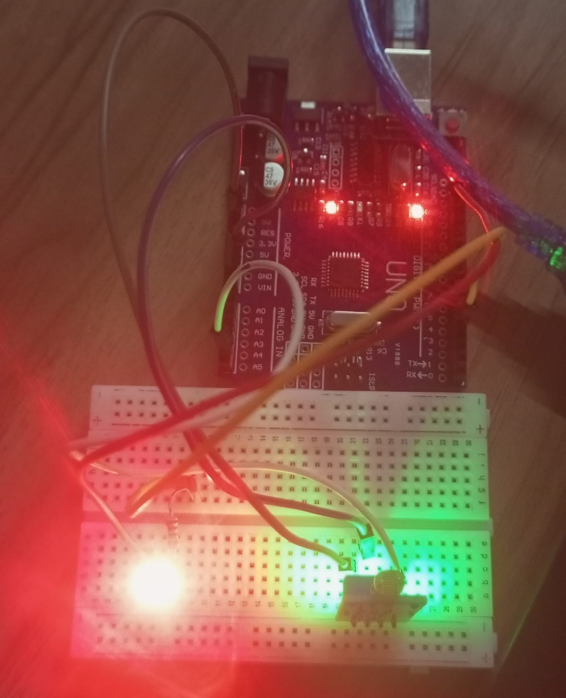

# LED-and-LDR-sensor
# About
A simple Arduino project that uses an LDR sensor to detect light levels and automatically control an LED. The LED glows in darkness and switches OFF in bright light.
# Components Required
- Arduino Uno
- LDR Sensor
- LED
- Resistor
- Breadboard
- Jumper Wires
# Working
1. The LDR detects the surrounding light.
2. Arduino reads the light level.
3. When it detects DARK, the LED turns ON.
4. When it detects BRIGHT, the LED turns OFF.
# Output

# Arduino Code
[View Arduino Code](./ledandldr.ino)

# Learning Outcome
Learned how to use an LDR sensor, read light values, and control an LED using Arduino.
